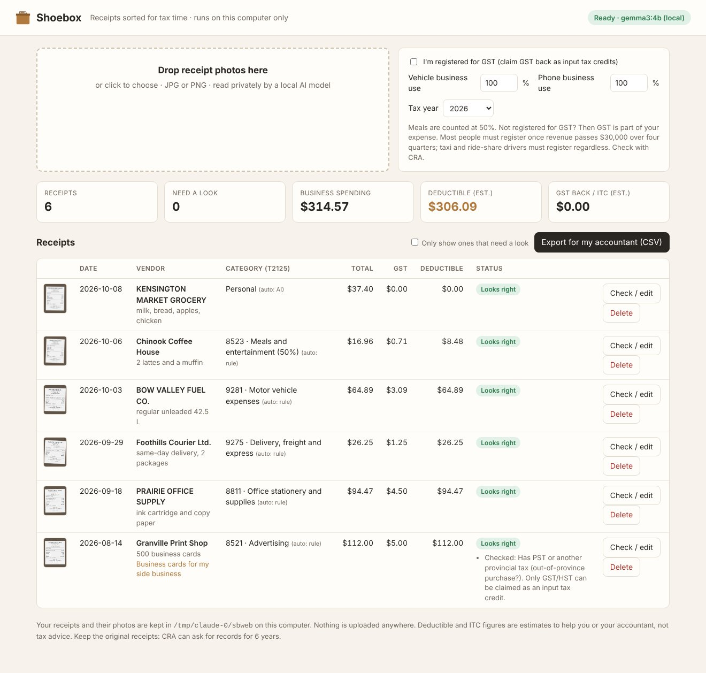
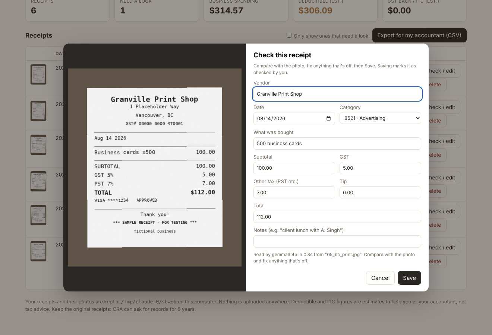

# Shoebox 🧾

[](https://github.com/GurminderKaur/Shoebox/actions/workflows/ci.yml)

**Sort a year of receipts for tax time, privately, on your own computer.**

You drop in photos of your receipts. A local open-weight AI model (Google's **Gemma 3**, run through **Ollama**) reads the vendor, date, subtotal, GST and total. Shoebox then:

- **checks the arithmetic itself**, flagging any receipt where the numbers don't add up, the tax isn't Alberta's 5% GST, or the date looks wrong;
- sorts each expense into its **CRA T2125 line**;
- totals your **deductible expenses and GST input tax credits**;
- exports a CSV for you or your accountant.

It's built for Alberta freelancers and gig workers: drivers, realtors, stylists, trades, consultants.



**Nothing leaves your computer.** The web page is served from `127.0.0.1` only. The AI model runs on your own machine. Receipts are stored in a normal folder (`~/Shoebox`) that you can back up or delete.

## What it does

| | |
|---|---|
| 📷 **Reads receipts** | Gemma 3 (4B, vision) runs locally through Ollama, using structured JSON output. Any Ollama vision model can be swapped in with `--model`. |
| ➗ **Checks the AI** | Plain C# arithmetic, not AI: subtotal + GST + tip = total; GST ≈ 5%; PST or HST from out of province; dates in the future or more than 7 years old; possible duplicates. |
| 🗂️ **Sorts for CRA** | Each receipt gets a T2125 expense line: keyword rules first (gas → 9281 motor vehicle, coffee → 8523 meals), then the AI's suggestion. You can always override it. |
| 💵 **Does the tax maths** | Meals at 50%. Vehicle and phone at your business-use %. If you're **GST-registered**, it deducts the pre-GST cost and totals your input tax credits. If you're not, GST is part of your expense. |
| ✅ **You stay in charge** | Side-by-side photo and fields for every receipt. Problems stay flagged until they're fixed. Cautions (like a PST receipt) clear once you've checked and saved. |
| 📤 **Exports** | CSV with one row per receipt plus a summary by T2125 line. Opens in Excel or Google Sheets. Protected against spreadsheet formula injection. |



## Set up on Windows (about 15 minutes)

Run these in **PowerShell**:
```powershell
winget install -e --id Microsoft.DotNet.SDK.8
winget install -e --id Ollama.Ollama
winget install -e --id Git.Git
# close and reopen PowerShell, then:
ollama pull gemma3:4b                      # ~3.3 GB, one time
mkdir $HOME\source\repos -Force; cd $HOME\source\repos
git clone https://github.com/GurminderKaur/Shoebox.git
cd Shoebox\src\Shoebox
dotnet run -c Release
```
Your browser opens at **http://127.0.0.1:5178**. Drop in receipt photos (JPG or PNG). Each one takes roughly 10–60 seconds to read, depending on your computer.

Prefer not to install .NET? Download the ready-made app for Windows, macOS or Linux from [Releases](https://github.com/GurminderKaur/Shoebox/releases), unzip it, and run `shoebox` (`shoebox.exe` on Windows). You still need Ollama with `gemma3:4b`. On Windows, if SmartScreen warns about an unknown app, click **More info → Run anyway**: the app isn't code-signed.

macOS and Linux work the same way: install the .NET 8 SDK and Ollama, then `dotnet run -c Release` in `src/Shoebox`.

### Options
```
shoebox                     start the app (opens your browser)
shoebox scan <folder>       read every JPG/PNG in a folder and print a table, with no browser
shoebox selftest            run the built-in checks

--model gemma3:12b          any Ollama vision model (more accurate, slower), env SHOEBOX_MODEL
--data <folder>             where receipts are stored (default ~/Shoebox), env SHOEBOX_DATA
--port 5178  --no-browser  --year 2026  --csv out.csv
```

## How well does the AI read receipts?

On every push, [CI](.github/workflows/ci.yml) runs the real `gemma3:4b` on the six clearly-labelled **sample receipts** in `samples/` (fictional businesses) and scores each field against the known values. The latest results, on a CPU-only GitHub runner at about 80 seconds per receipt:

| Field | Vendor | Date | Subtotal | GST | Total | Category |
|---|---|---|---|---|---|---|
| Correct | 6/6 | 6/6 | 6/6 | **4/6** | 6/6 | 5/6 |

The two GST misreads are instructive:
- **Courier receipt:** the model read GST as **$25.00**, copying the subtotal, instead of $1.25. Two checks flagged it: *"Amounts don't add up (off by $23.75)"* and *"GST is 100% of the subtotal"*.
- **Grocery receipt:** the receipt shows **$0.00 GST** (basic groceries are zero-rated), but the model filled in **$1.87**, which is exactly 5%. In other words, it "assumed" Alberta GST. Flagged: *"Amounts don't add up (off by $1.87)"*.

**Both misread amounts were flagged "needs a look"; neither slipped silently into the totals.** That's the design: the model reads, and plain arithmetic checks it. The grocery receipt was also filed as "Other" instead of "Personal". That's a judgement call no arithmetic can check, which is why every category shows whether it came from a rule, the AI or you.

To regenerate the samples: `python samples/make_samples.py` (needs Pillow).

## Why open models

- **Privacy:** receipts show where you go, what you buy and who your clients are. Here they never touch a server.
- **Cost:** no per-receipt API fees, ever. A year of receipts costs only the electricity to read them, which is what makes a cheap, one-time-price tool viable.
- **Control:** swap the model, tune the prompt, add rules for your trade, or run it on a laptop with no internet.

## Built with
- [.NET 8](https://dotnet.microsoft.com) (ASP.NET Core minimal API). **No third-party NuGet packages.**
- [Ollama](https://ollama.com) and [Gemma 3](https://ai.google.dev/gemma) (open weights, [Gemma Terms of Use](https://ai.google.dev/gemma/terms)).
- One self-contained HTML page: no CDNs or web fonts, so it works offline.

## Important
Shoebox gives **estimates to help you or your accountant. It is not tax advice.** Rules have details it doesn't model, including the capital cost allowance (CCA), home-office expenses, mixed personal/business receipts and HST provinces. Check with CRA or a professional. Keep your original receipts: CRA can ask for records for **6 years**.

GST notes: most businesses must register once taxable revenue passes **$30,000** over four consecutive quarters. **Taxi and ride-share drivers must register regardless of revenue.** Only registrants can claim input tax credits, and meals are limited to 50%.

## Licence
MIT. See [LICENSE](LICENSE). Gemma is used under the Gemma Terms of Use and isn't included in this repository.
